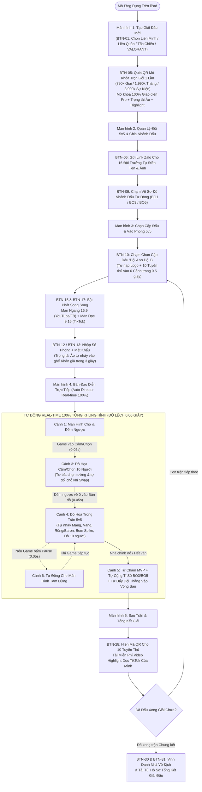
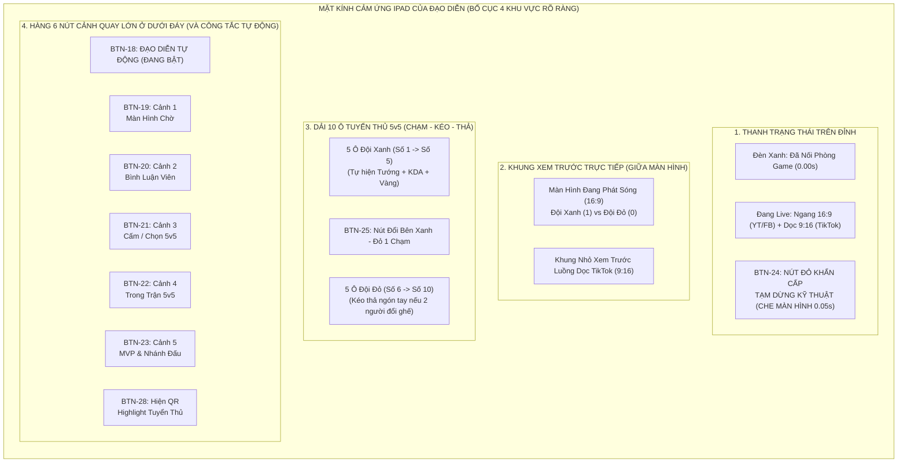
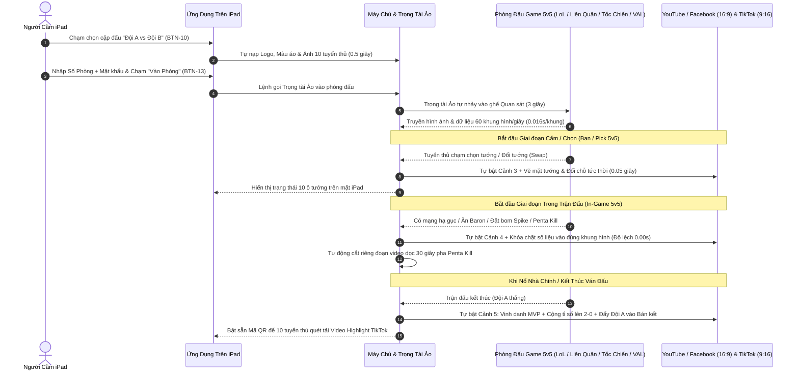
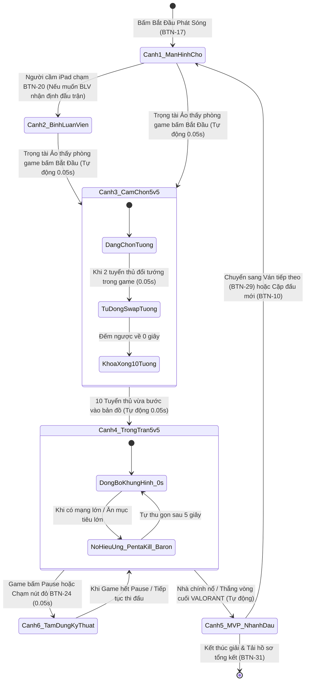

# TỔNG HỢP TOÀN BỘ NÚT BẤM TRÊN IPAD & SƠ ĐỒ LUỒNG NGƯỜI DÙNG (MOBA 5v5 & VALORANT)
*(Tài liệu liệt kê chi tiết từng nút chạm trên màn hình iPad của người làm giải và 4 sơ đồ luồng hoạt động từ đầu đến cuối)*

---

## PHẦN 1: BẢNG TỔNG HỢP TẤT CẢ 31 NÚT BẤM TRÊN MÀN HÌNH IPAD CỦA NGƯỜI DÙNG

Vì 99% việc đọc tướng, nhảy điểm, cộng tỉ số đã chạy **tự động Real-time**, trên mặt kính chiếc iPad của người làm giải chỉ có **31 nút bấm to, rõ ràng**, chia theo 5 màn hình từ lúc chuẩn bị đến lúc kết thúc giải:

### 1. Màn hình 1: Tạo Giải Đấu & Mở Khóa Trọn Gói (5 Nút bấm)

| Mã Nút | Tên Nút Hiển Thị Trên iPad | Chạm Vào Thì Chuyện Gì Xảy Ra? | Khi Nào Người Dùng Bấm? |
| :--- | :--- | :--- | :--- |
| **BTN-01** | **Chọn Tựa Game Thi Đấu (4 nút chọn: Liên Minh / Liên Quân / Tốc Chiến / VALORANT)** | Phần mềm tự nạp sẵn bộ khung đồ họa 5v5 và kho ảnh tướng/đặc vụ của đúng tựa game vừa chọn. | Bấm 1 lần lúc bắt đầu tạo giải đấu mới. |
| **BTN-02** | **Chọn Chế Độ Chạy (Chạy Đám Mây trên iPad / Nối PC trong phòng)** | Chọn dùng máy chủ Đám mây (chỉ cần cầm iPad) hoặc nối Wi-Fi với 1 máy tính đặt sẵn trong phòng máy. | Bấm 1 lần khi mở giải. |
| **BTN-03** | **Tải Lên Logo Giải & Logo Nhà Tài Trợ** | Mở kho ảnh của iPad để chọn ảnh Logo giải đấu và các nhà tài trợ tự động gắn lên mọi cảnh quay. | Bấm khi cài đặt hình ảnh giải đấu. |
| **BTN-04** | **Chọn Kho Giao Diện Động (Motion Theme)** | Đổi ngay toàn bộ áo đồ họa của giải sang phong cách Đấu Trường Danh Vọng, Chung Kết Thế Giới, VCS, VCT... | Bấm khi muốn đổi phong cách đồ họa. |
| **BTN-05** | **Mở Khóa Trọn Gói (790k Giải / 1.990k Tháng / 3.900k Sự kiện)** | Hiện mã QR ngân hàng (hoặc Apple Pay); quét xong trong 3 giây là mở khóa 100% tính năng cho cả giải, không hỏi mua thêm lần nào nữa. | Bấm 1 lần duy nhất trước khi giải bắt đầu. |

---

### 2. Màn hình 2: Quản Lý Đội Tuyển 5v5 & Sơ Đồ Nhánh Đấu (6 Nút bấm)

| Mã Nút | Tên Nút Hiển Thị Trên iPad | Chạm Vào Thì Chuyện Gì Xảy Ra? | Khi Nào Người Dùng Bấm? |
| :--- | :--- | :--- | :--- |
| **BTN-06** | **Copy Link Đăng Ký Gửi Cho Đội Trưởng** | Tạo 1 đường link để gửi vào Zalo cho 16 đội trưởng tự điền tên 5 thành viên và tải ảnh lên (chủ giải không phải tự gõ). | Bấm khi bắt đầu mở đăng ký giải. |
| **BTN-07** | **Nhập Nhanh Danh Sách Đội Từ File / Thư Mục Ảnh** | Nếu chủ giải đã có sẵn danh sách và thư mục ảnh trên máy, bấm nút này để nạp toàn bộ 16-32 đội vào iPad trong 5 giây. | Bấm nếu tự nhập danh sách đội. |
| **BTN-08** | **Chọn Thể Thức Giải (Loại trực tiếp / Nhánh thắng-thua / Vòng tròn)** | Quy định cách chia bảng và số ván thắng (Đấu chạm 1 - BO1, chạm 2 - BO3, chạm 3 - BO5). | Bấm trước khi bốc thăm chia cặp. |
| **BTN-09** | **Bốc Thăm & Vẽ Sơ Đồ Nhánh Đấu Tự Động** | Tự động trộn ngẫu nhiên các đội và vẽ ra sơ đồ nhánh đấu (Tứ kết, Bán kết, Chung kết) ngay trên mặt kính iPad. | Bấm khi đã chốt xong danh sách các đội. |
| **BTN-10** | **Chạm Chọn Cặp Đấu ("Đưa Trận Này Lên Phòng Live")** | Chạm vào cặp đấu bất kỳ trên nhánh đấu -> Toàn bộ Logo, màu áo, tên đội và 10 tuyển thủ của 2 đội đó tự nạp sẵn vào 6 cảnh phát sóng trong 0.5 giây. | Bấm trước mỗi trận đấu sắp diễn ra. |
| **BTN-11** | **Xuất Ảnh Sơ Đồ Nhánh Đấu Đăng Fanpage** | Xuất ngay 1 tấm ảnh nét căng vẽ sơ đồ nhánh đấu và tỉ số mới nhất lưu vào iPad để đăng lên Facebook/Zalo thông báo. | Bấm sau mỗi vòng đấu hoặc cuối ngày. |

---

### 3. Màn hình 3: Kết Nối Phòng Game 5v5 & Kênh Phát Sóng (6 Nút bấm)

| Mã Nút | Tên Nút Hiển Thị Trên iPad | Chạm Vào Thì Chuyện Gì Xảy Ra? | Khi Nào Người Dùng Bấm? |
| :--- | :--- | :--- | :--- |
| **BTN-12** | **Tạo Mã Phòng Giải Đấu Tự Động (Dành cho Liên Minh PC)** | Tự tạo phòng đấu tùy chọn 5v5 trong Liên Minh Huyền Thoại và hiện mã phòng để gửi cho 10 tuyển thủ dán vào game. | Bấm trước trận nếu làm giải Liên Minh PC. |
| **BTN-13** | **Nhập Số Phòng + Mật Khẩu -> "Gọi Trọng Tài Ảo Vào Phòng"** | Gõ Số Phòng (ID) và Mật khẩu rồi chạm nút này -> Tài khoản Trọng tài Ảo tự động nhảy vào ngồi ghế Quan sát (Khán giả) của phòng đấu trong 3 giây. | Bấm trước mỗi trận Liên Quân, Tốc Chiến, VALORANT. |
| **BTN-14** | **Lấy Link Nối Camera Bình Luận Viên (Caster Link)** | Tạo đường link gửi cho 1 hoặc 2 Bình luận viên bấm vào bằng điện thoại/laptop để truyền thẳng mặt và giọng nói vào khung Bình luận viên. | Bấm 1 lần đầu buổi phát sóng. |
| **BTN-15** | **Chọn Kênh Phát Sóng (YouTube / Facebook / TikTok / Twitch)** | Bật/tắt các kênh muốn phát trực tiếp và tự động bật chế độ tách đôi **Màn Ngang (16:9)** + **Màn Dọc (9:16 cho TikTok)**. | Bấm 1 lần trước khi lên sóng. |
| **BTN-16** | **Chọn Độ Trễ Chống Nhìn Trộm (0 giây / 15 giây / 30 giây / 2 phút)** | Làm chậm luồng phát đi đúng số giây đã chọn (cả hình ảnh game lẫn con số trên bảng tỉ số đều chậm khớp nhau 100%). | Bấm nếu giải đấu cần chống tuyển thủ xem trộm live. |
| **BTN-17** | **Nút Lớn: "BẮT ĐẦU PHÁT SÓNG (GO LIVE)"** | Bắt đầu đẩy video và âm thanh trực tiếp lên toàn bộ các kênh YouTube, Facebook, TikTok đã chọn, đồng thời tự ghi hình vào ổ cứng. | Bấm khi bắt đầu buổi livestream. |

---

### 4. Màn hình 4: Bàn Đạo Diễn Trực Tiếp (Live Deck) - Các nút chạm trong trận (10 Nút bấm)

*(Lưu ý: Bình thường công tắc **BTN-18: Đạo Diễn Tự Động** được bật sẵn nên phần mềm tự chuyển cảnh từ đầu đến cuối trận; các nút bên dưới giúp người cầm iPad chủ động can thiệp bất cứ lúc nào chỉ bằng 1 chạm)*:

| Mã Nút | Tên Nút Hiển Thị Trên iPad | Chạm Vào Thì Chuyện Gì Xảy Ra? | Khi Nào Người Dùng Bấm? |
| :--- | :--- | :--- | :--- |
| **BTN-18** | **Công Tắc: "Đạo Diễn Tự Động 100% (Auto-Director)"** | Khi bật (mặc định): Phần mềm tự chuyển cảnh theo game (Phòng chờ -> Cấm/Chọn -> Trong trận -> MVP & Nhánh đấu) mà không cần bấm tay. | Luôn bật sẵn mặc định. |
| **BTN-19** | **Nút Cảnh 1: "Màn Hình Chờ & Đếm Ngược Trước Trận"** | Chiếu màn hình chờ có Logo Đội Xanh vs Đội Đỏ, đồng hồ đếm ngược 05:00 phút, lịch thi đấu và nhạc nền. | Tự bật trước trận hoặc chạm tay khi nghỉ giải lao. |
| **BTN-20** | **Nút Cảnh 2: "Bàn Bình Luận Viên (Caster Desk)"** | Chiếu khung hình lớn của 1 hoặc 2 Bình luận viên đang nhận định trước/sau trận đấu kèm tỉ số cặp đấu. | Chạm khi muốn chiếu Bình luận viên nói chuyện giữa 2 ván. |
| **BTN-21** | **Nút Cảnh 3: "Màn Hình Cấm / Chọn 10 Người (Ban/Pick)"** | Chiếu giao diện Cấm/Chọn 5v5 đang tự động nhảy mặt tướng, tên tuyển thủ và đồng hồ đếm ngược theo thời gian thực. | Tự động bật ngay khi game bước vào Cấm/Chọn. |
| **BTN-22** | **Nút Cảnh 4: "Màn Hình Trong Trận Đấu 5v5 (In-Game)"** | Chiếu trận đấu kèm thanh tỉ số đỉnh màn hình, 2 cột 10 người chơi, chênh lệch vàng, Rồng/Baron/Spike và khung nhỏ Bình luận viên. | Tự động bật ngay khi 10 người chơi vào bản đồ. |
| **BTN-23** | **Nút Cảnh 5: "Thống Kê Sau Trận, Vinh Danh MVP & Nhánh Đấu"** | Chiếu bảng kết quả ván đấu, hình ảnh lớn của Tuyển thủ MVP và sơ đồ nhánh đấu vừa tự động nhảy tỉ số. | Tự động bật ngay khi nổ nhà chính / kết thúc ván. |
| **BTN-24** | **NÚT ĐỎ KHẨN CẤP (Cảnh 6): "TẠM DỪNG KỸ THUẬT (CHE MÀN HÌNH)"** | Che kín màn hình trận đấu ngay trong **0.05 giây** (tránh lộ vị trí mắt/chiến thuật) và hiện thông báo *"Trận đấu đang tạm dừng kỹ thuật"*. | Tự động bật khi game Pause hoặc chạm tay khi có sự cố. |
| **BTN-25** | **Nút "Đổi Bên Xanh - Đỏ 1 Chạm (Swap Sides)"** | Đảo toàn bộ Logo, Tên đội, Màu áo và 5 tuyển thủ của Đội Xanh và Đội Đỏ sang phía đối diện trong 0.1 giây. | Chạm khi sang ván đấu mới mà 2 đội đổi bên cho nhau. |
| **BTN-26** | **Thao Tác Chạm - Kéo - Thả Ô Tuyển Thủ / Ô Tướng Trên Mặt Kính** | Lấy ngón tay kéo ô số 1 thả sang ô số 3 (hoặc gõ 2 chữ cái đầu tên tướng) để đổi vị trí hoặc đổi tướng ngay lập tức nếu 2 người đổi máy ngồi. | Chỉ dùng trong trường hợp 2 tuyển thủ ngoài đời tự đổi ghế cho nhau. |
| **BTN-27** | **Thanh Trượt Âm Thanh (Tiếng Game / Tiếng Bình Luận Viên / Nhạc Nền)** | Tăng/giảm âm lượng từng nguồn âm thanh và bật chế độ *"Tự động nhỏ nhạc nền khi Bình luận viên cất tiếng nói"*. | Chạm chỉnh khi muốn to/nhỏ tiếng game hoặc micro. |

---

### 5. Màn hình 5: Sau Trận Đấu & Tổng Kết Giải (4 Nút bấm)

| Mã Nút | Tên Nút Hiển Thị Trên iPad | Chạm Vào Thì Chuyện Gì Xảy Ra? | Khi Nào Người Dùng Bấm? |
| :--- | :--- | :--- | :--- |
| **BTN-28** | **Nút "Hiện Mã QR Tải Video Highlight Cho 10 Tuyển Thủ"** | Bật mã QR lớn trên màn hình iPad (và trên góc livestream) để 10 tuyển thủ vừa đánh xong quét mã tải miễn phí các clip Triple Kill / Penta Kill dọc TikTok của mình. | Bấm sau mỗi ván đấu hoặc cuối cặp đấu. |
| **BTN-29** | **Nút "Chuyển Sang Ván Tiếp Theo (Game 2 / Game 3)"** | Giữ nguyên 2 đội hiện tại, tăng số thứ tự ván đấu lên Ván 2 (hoặc Ván 3) và sẵn sàng đón Trọng tài Ảo vào trận tiếp theo. | Bấm giữa các ván trong kèo BO3 / BO5. |
| **BTN-30** | **Nút "Vinh Danh Nhà Vô Địch Chung Cuộc"** | Bật cảnh pháo hoa rực rỡ, cúp vô địch cùng Logo và đội hình 5 người của Đội Vô Địch giải đấu. | Bấm sau khi kết thúc trận Chung kết của giải. |
| **BTN-31** | **Nút "Kết Thúc Phát Sóng & Tải Túi Hồ Sơ Tổng Kết Giải"** | Ngắt luồng phát sóng an toàn và gom sẵn Ảnh nhánh đấu chung cuộc + Toàn bộ video các trận + Báo cáo tổng lượt xem để gửi cho Nhà tài trợ. | Bấm ở cuối ngày khi giải đấu khép lại. |

---

## PHẦN 2: BỘ 4 SƠ ĐỒ LUỒNG NGƯỜI DÙNG & HỆ THỐNG TỰ ĐỘNG REAL-TIME

### Sơ đồ 1: Luồng Tổng Thể Từ Lúc Mở iPad Đến Lúc Kết Thúc Giải Đấu (End-to-End User Flow)

---

### Sơ đồ 2: Bố Cục Các Nút Bấm Trên Màn Hình Cảm Ứng iPad Lúc Đang Phát Sóng (iPad Live Deck Layout)

---

### Sơ đồ 3: Luồng Phối Hợp Tự Động Real-Time Giữa iPad, Trọng Tài Ảo Và Phòng Game 5v5

---

### Sơ đồ 4: Sơ Đồ Tự Động Chuyển 6 Cảnh Quay Theo Nhịp Trận Đấu (State Diagram)

